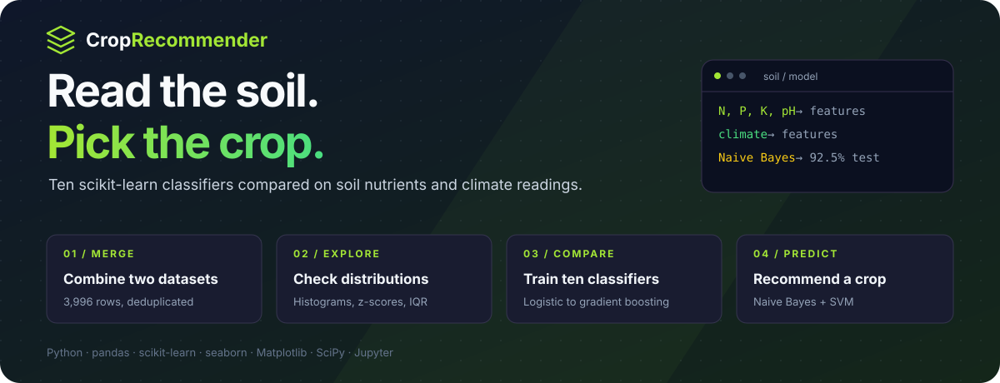

<p align="center">
  
</p>

<p align="center">
  <strong>Crop recommendation with machine learning.</strong><br />
  Recommend the most suitable crop from soil nutrients (N, P, K), pH, temperature, humidity and rainfall.
</p>

<p align="center">
  
  
  
  
</p>

<p align="center">
  <a href="#the-product">Product</a> ·
  <a href="#engineering-decisions">Engineering</a> ·
  <a href="#results">Results</a> ·
  <a href="#run-locally">Run locally</a> ·
  <a href="#creator">Creator</a>
</p>

---

## The product

Choosing what to plant is usually based on habit or neighbours' choices, not on what the soil and climate actually support. A wrong choice costs a full season.

**This project learns which crops grow under which conditions and recommends one for new readings.** It merges two agricultural datasets, cleans and explores them, compares ten classifiers on the same split, and turns the best models into an interactive prediction function.

| Capability | What you can do |
| :--- | :--- |
| **Data preparation** | Merge two datasets (2,200 + 1,796 rows), check missing values and remove duplicate readings. |
| **Exploratory analysis** | Histograms, box plots, descriptive statistics, z-score and IQR outlier checks. |
| **Model comparison** | Train and score ten scikit-learn classifiers on the same scaled train/test split. |
| **Evaluation** | Accuracy, weighted precision, recall and F1, 5-fold cross-validation and learning curves. |
| **Prediction** | Enter N, P, K, temperature, humidity, pH and rainfall and get a recommended crop. |

### A workflow you can follow

**Load → clean → merge → explore → scale → compare models → evaluate → predict**

## Engineering decisions

| Engineering problem | Implementation | Where |
| :--- | :--- | :--- |
| Two sources overlap | The datasets are concatenated, then deduplicated on the seven feature columns so repeated readings don't leak between train and test. | *Feature Engineering* section |
| Features use very different scales (rainfall vs pH) | `StandardScaler` is fit on the training split only and applied to the test split. | *Modelling process* |
| One model's score says little on its own | Ten classifiers are trained on the same split and compared side by side. | *Insights and Recommendations* |
| A single split can be lucky | 5-fold cross-validation and learning curves check that accuracy is stable. | *Model Evaluation* |

All steps are in [`Crop recommendation .ipynb`](Crop%20recommendation%20.ipynb).

## Results

Test accuracy on a 20% hold-out split (`random_state=42`), as recorded in the notebook:

| Model | Test accuracy |
| :--- | :--- |
| **Gaussian Naive Bayes** | **92.53%** |
| Support Vector Machine | 91.84% |
| K-Nearest Neighbors | 88.72% |
| Logistic Regression | 87.67% |
| Random Forest | 87.50% |
| Bagging | 86.63% |
| Gradient Boosting | 85.42% |
| Decision Tree | 82.64% |
| Extra Trees | 78.82% |
| AdaBoost | 12.33% |

For Naive Bayes: training accuracy 93.26%, weighted precision 89.02%, recall 92.53%, F1 90.19%, and mean 5-fold cross-validation accuracy **92.39%**. Training and test scores are close, so the model is not simply memorizing the training data.

<details>
<summary><strong>Scope and known limitations</strong></summary>

- The merged data covers the crops in these two datasets (22 and 19 classes); other crops cannot be recommended.
- AdaBoost with default settings performs very poorly here and would need tuning.
- Prediction runs inside the notebook through `input()` prompts; there is no web interface yet.
- The data files are CSV text even though they carry an `.xls` extension (see Run locally).

</details>

## Run locally

```bash
git clone https://github.com/Lingu17/Crop-recommendation-using-machine-learing.git
cd Crop-recommendation-using-machine-learing
pip install pandas numpy scikit-learn scipy seaborn matplotlib jupyter
```

The notebook reads `Crop_data1.csv` and `Crop_data2.csv`. The repository stores the same data as `crop_data1 (1).xls` and `crop_data2 (1).xls` (plain CSV), so copy them to the expected names first:

```bash
cp "crop_data1 (1).xls" Crop_data1.csv
cp "crop_data2 (1).xls" Crop_data2.csv
jupyter notebook "Crop recommendation .ipynb"
```

Run all cells. The prediction cells ask for the seven input values and print the recommended crop.

## Project map

```text
Crop-recommendation-using-machine-learing/
├── Crop recommendation .ipynb   Cleaning, EDA, model comparison, evaluation, prediction
├── crop_data1 (1).xls           Dataset 1: 2,200 rows, 22 crops (CSV format)
└── crop_data2 (1).xls           Dataset 2: 1,796 rows, 19 crops (CSV format)
```

## Creator

**Lingraj Malipatil** · [GitHub @Lingu17](https://github.com/Lingu17) · [LinkedIn](https://www.linkedin.com/in/lingraj-malipatil-a2735a241/)

---

<p align="center"><strong>Crop Recommender</strong><br />Read the soil. Pick the crop.</p>
